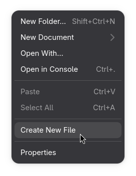
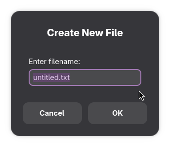

# Universal File Creator

A lightweight GNOME Files (Nautilus) extension that allows you to create files with any extension directly from the right-click context menu.

No terminal commands. No predefined templates. Just enter a filename and create your file.

## Features

- Create files with any extension.
- Simple graphical filename input.
- Integrated into the Nautilus right-click context menu.
- Lightweight and easy to use.
- Automatic installation and uninstallation scripts.
- Prevents accidental overwriting of existing files.

## Preview



## Examples

You can create files such as:

- `main.py`
- `index.html`
- `style.css`
- `script.js`
- `program.cpp`
- `README.md`
- `config.json`

Simply right-click inside a folder, select **Create New File**, and enter your desired filename.

## Requirements

- GNOME Desktop Environment
- GNOME Files (Nautilus)
- Python Nautilus bindings
- Zenity

## Installation

### Automatic Installation

1. Download the repository using **Code → Download ZIP**.
2. Extract the downloaded archive.
3. Open a terminal inside the extracted project directory.
4. Run:

```bash
bash install.sh
```

5. Restart Nautilus if necessary.

The installer detects supported package managers and installs the required dependencies.

### Manual Installation

Install the required dependencies for your Linux distribution, then copy the Python extension into:

```text
~/.local/share/nautilus-python/extensions/
```

Restart Nautilus to activate the extension.

## Usage

1. Open GNOME Files.
2. Navigate to your desired folder.
3. Right-click on an empty area.
4. Select **Create New File**.
5. Enter a filename including its extension.
6. Press Enter.

Your file will be created immediately.

## Uninstallation

Open a terminal inside the project directory and run:

```bash
bash uninstall.sh
```

## Supported Distributions

The installer includes package-manager detection for:

- Arch Linux
- Debian / Ubuntu
- Fedora
- openSUSE

Compatibility may vary depending on distribution repositories and Nautilus versions.

## Project Structure

```text
Universal-File-Creator/
├── universal_file_creator.py
├── install.sh
├── uninstall.sh
├── README.md
├── LICENSE
├── .gitignore
└── screenshots/
    └── preview.png
```

## Contributing

Contributions, bug reports, and feature suggestions are welcome!

Feel free to fork this repository and submit a pull request.

## License

This project is licensed under the MIT License. See the `LICENSE` file for details.

---

Made for GNOME users who want a simpler way to create files.